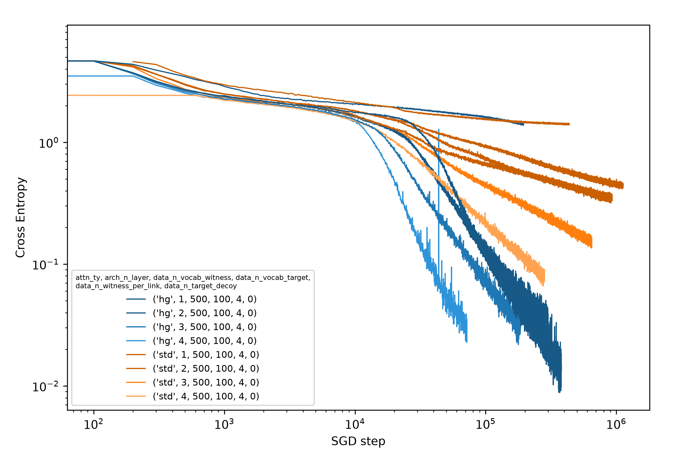
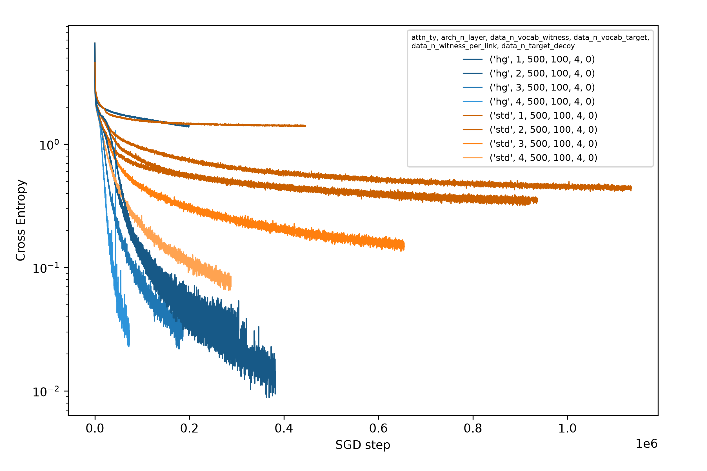

# Witness-gated Associative Recall

<p>Testing Hypergraph vs. Traditional Attention</p>

---

## Synthetic Task Desiderata

* **deterministic** - cross entropy goes to zero when solved
* **unhackable** - there are no shortcuts.  a right answer means the intended mechanism was used
* **inexhaustible** - training examples are very unlikely to repeat
* **short MDL** - task generating algorithm isn't meant to test bulk knowledge acquisition

---

## Why not real world data / tasks?

* generalization failures in Frontier models are increasingly rare
* real datasets contain very few failure examples
* we'd like to isolate these
* we hope to design a variety of synthetic tasks, each testing a low level skill

---

## Deterministic Associative Recall

```
[Target Pool] = [T1 T2 T3 ... Tk]
```

Token `Ti` on the rhs is one of the targets associated with query `i` in a
hidden query-target store.

Although the hidden store may have many targets for a given query, the target
pool is carefully selected so that only one appears.

Think:  uttering an unambiguous sentence.  Any given word can have many
associated words, but you choose only one, so the listener can parse it.

---

## Motivation - concepts as tuples of associated concepts

Some concepts combine just a **pair** of other concepts

- *shoe* -> (feet, covering)
- *envelope* -> (flat, container)
- *valve* -> (one-way, barrier)
- *PCR* -> (synthesis, exponential growth)

Others combine a **triple** of concepts

- *shadow* -> (light, occlusion, target surface)
- *friction* -> (surface, motion, resistance)
- *betrayal* -> (truster, trustee, harm)
- *ddPCR* -> (PCR, compartmentalization, boolean readout)
- *lagrange method* -> (constraint, expansion, differentiability)
- *tragic hero* -> (nobility, internal flaw, disproportionate fall)
- *The McGuffin* -> (desired object, mutually conflicting pursuers, narrative irrelevance)

---

## Associative Memory as biadjacency matrix 

* columns are queries
* rows are targets

<div class="video-row">
<div class="video-col">
![[video/10_cover_single.webm]]
</div>
</div>

---

## Exact Cover with Witnesses (nonfactored graph)

<div class="video-row">
<div class="video-col">
![[video/10_active_sets_nonfactored.webm]]
</div>
</div>

---

## Exact Cover with Witnesses (factored graph)

<div class="video-row">
<div class="video-col">
![[video/10_active_sets_factored.webm]]
</div>
</div>

---

## Three Edge Dataset

Quest:  find some task that exposes a 1-2 layer capability gap between
traditional and hypergraph transformer. 

Token Vocabulary consts of disjoint subsets:

```bash
Q: query tokens (~= 10)
W: witness tokens (~= 100)
T: target tokens (~= 1000)

[T T W T W W T W T T T][Q Q Q Q Q] = [T T T T T]
```

Each q in the query section will form at least one triple `(q,w,t)` s.t.
`(w,t)` in Pool and `(q,w,t)` in H.   The t is retrieved and placed in the target
section.

If more than one triple exists, the t will be the same, making retrieval
deterministic Not all T in the pool need be retrieved T and/or W can be reused
by multiple queries

---

## Training Results: Hypergraph vs. Traditional Attention



---



---


---

## Aside - Implementing DFS on GPU

<div class="code-row">
<div class="code-col">

<p>Traditional (recursive) form</p>

```python
# Original function
def search(node: Node, rng: Generator) -> Node|None:
    if node.hit:
        return node

    perm = rng.permutation(len(node.children)) 
    for p in perm:
        child = node.children[p]
        hit = search(child, rng)
        if hit is not None:
            return hit 
    return None
```

</div>

<div class="code-col">

<p>Reified stack form</p>

```python
@dataclass
class Frame:
    node: Node | None = None
    perm: np.ndarray | None = None
    loop_idx: int = 0
    found: bool = False
    in_backtrack: bool = False

def update_stack(stack: list[Frame], rng) -> list[Frame]:
    fr = stack[-1]

    if fr.in_backtrack:
        return backtrack(stack)

    if fr.node.hit:
        fr.found = True
        return stack

    # entering node for the first time
    if fr.perm is None:
        fr.perm = rng.permutation(len(fr.node.children))
        fr.loop_idx = 0

    if fr.loop_idx < fr.perm.size:
        return visit_child(stack)
    else:
        return backtrack(stack)


def search_loop(node, rng) -> Node | None:
    stack = [Frame(node)]
    while stack and not stack[-1].found:
        stack = update_stack(stack, rng)

    if len(stack):
        return stack[-1].node
    return None
```

</div>
</div>

---

## Aside - Implementing DFS on GPU

* different batch lanes will be in different phases (visit_child or backtrack)
* running time is the slowest lane; need iteration limit
* you get huge speedup and no CPU <=> GPU delay

<div class="code-row">
<div class="code-col">

```python
class Stack(eqx.Module):
	status: Int8[Array, ""]
	resume_backtrack: Bool[Array, ""]
	col_D: Int[Array, "D"]        # column at stack frame d
	n_child_D: Int[Array, "D"]    # number of children (-1 if not yet visited)
	child_idx_D: Int[Array, "D"]  # next child to try, in [0, n_child_D[d])
	top: Int[Array, ""]           # the top of the stack


def _loop_search(key: PRNGKeyArray) -> State:
    def cond_fn(cry):
        step, state = carry
    return (state.top >= 0) & (state.status == RUNNING) & (step < max_search_steps)

    def body_fn(carry):
        step, state = carry
        return step + 1, update_stack(step, state)

    init_state = jnp.int32(0), State.root(D, R, W, key)
    return jax.lax.while_loop(cond_fn, body_fn, init_state)

batch_search = jax.jit(jax.vmap(_loop_search))

res = batch_search(keys)
```

</div>
</div>


