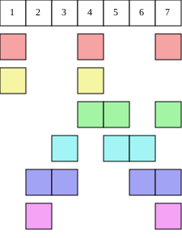
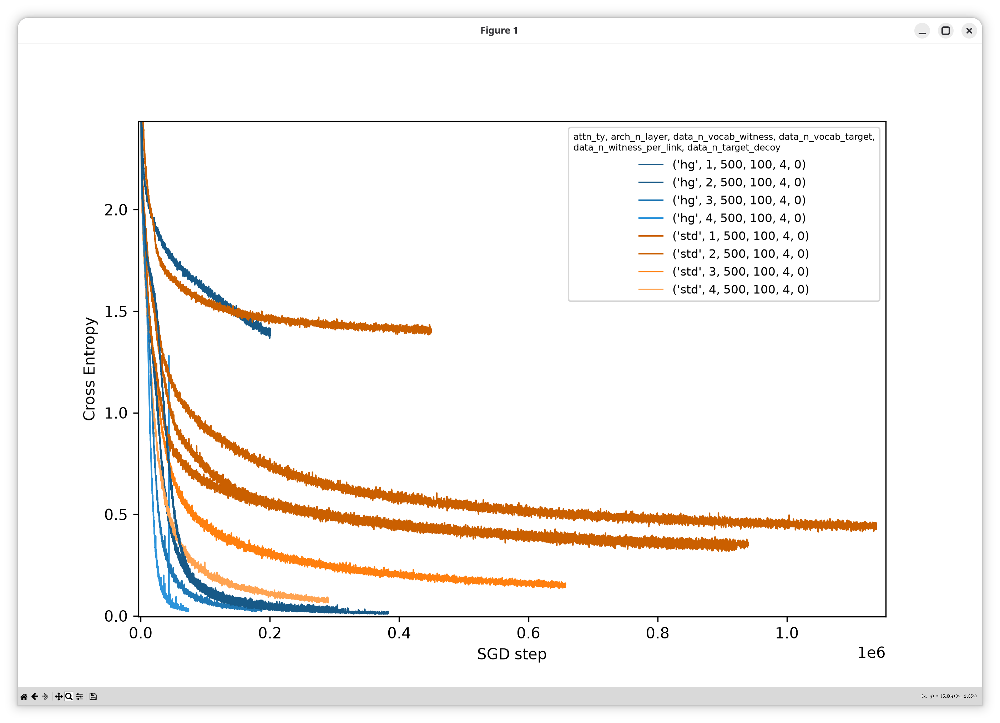

# Witness-gated Associative Recall

<p>Testing Hypergraph vs. Traditional Attention</p>

---

## Synthetic Task Desiderata

* **deterministic** - cross entropy goes to zero when solved

* **unhackable** - there are no shortcuts.  a right answer means the intended mechanism was used
* **inexhaustible** - training examples are very unlikely to repeat
* **short MDL** - task generating algorithm isn't meant to test bulk knowledge acquisition

---

## Why not real world data / tasks?

* generalization failures in frontier models are increasingly rare

* real datasets contain very few failure examples
* we'd like to isolate these
* we hope to design a variety of synthetic tasks, each testing a low level skill

---

## Motivation - concepts as tuples of associated concepts

Some concepts combine just a **pair** of other concepts

- *shoe* -> (feet, covering)
- *envelope* -> (flat, container)
- *valve* -> (one-way, barrier)
- *PCR* -> (synthesis, exponential growth)

Others combine a **triple** of concepts

- *shadow* -> (light, occlusion, target surface)
- *friction* -> (surface, motion, resistance)
- *betrayal* -> (truster, trustee, harm)
- *ddPCR* -> (PCR, compartmentalization, boolean readout)
- *lagrange method* -> (constraint, expansion, differentiability)
- *tragic hero* -> (nobility, internal flaw, disproportionate fall)
- *The McGuffin* -> (desired object, mutually conflicting pursuers, narrative irrelevance)

---

## Context can gate a one-to-many association

* A given concept is globally associated with many concepts

**light** -> (*dark, sun, electricity, heat, color, hope, ambition, awareness*)

### Examples of sentences that contain the concept of "light"

* His hopes faded.

* The hippo was dimly aware of the submerged aligator.
* The brightest minds in the room spotted the problem instantly.
* She lives in a beige house with a beige car.
* He led a colorful life.

---

## What is an Exact Cover?


```
# Given:
graph_RC: bool[R, C]
mask_R: bool[R]

mask_R is an **exact cover** iff:

(graph_RC[mask_R,:].sum(axis=0) == 1).all()
```



---

## Witness-gated associative recall task

```text
graph_RWC: bool[R, W, C] - a hidden tri-adjacency tensor to be learned
W: witness tokens
T: target tokens

[T T W T W W T W T T T] = [T T T T T]
[ target-witness pool ]   [predicted]

Select target-witness pool as an exact cover solution to graph_RWC
The i'th prediction is the covering row for the i'th column in graph_RWC 
```

```
def valid_exact_cover(graph_RWC, mask_R, mask_W) -> bool:
    """
    A selection of rows and witnesses is a valid witness-gated exact cover iff
    the witness-marginal of the filtered graph forms an exact cover

    An exact cover is a selection of rows such that every column has exactly
    one active element. (

    Inputs:
    graph_RWC: bool[R, W, C] tri-adjacency graph
    mask_R: bool[R] mask of active rows
    mask_W: bool[W] mask of active witnesses

    Output: whether (mask_R, mask_W) is a valid witness-gated exact cover solution
    """
		marg_RC = graph_RWC[*np.ix_(mask_R, mask_W),:].any(1)
		return bool((marg_RC.sum(0) == 1).all())
```

---

## Witness-gated Exact cover Demos

- [2D (degenerate case)](
https://www.mlcrumbs.com/witness_cover/rwc_viewer.html?tensor=./2d.npy&sets=./2d.txt&m=file&rls=1.9&wls=1.9&cls=1.9&ilo=0.17&fov=0.272&z=1.34&asp=fill&td=1&y=10.3&p=6.7&set=1
): 
Exact Cover (equivalent to one always-present witness)

- [3D (nonfactored adjacency graph)](
https://www.mlcrumbs.com/witness_cover/rwc_viewer.html?tensor=./nfac.npy&sets=./nfac.txt&m=file&rls=1.9&wls=1.9&cls=1.9&ilo=0.17&fov=0.272&z=1.27&asp=fill&td=1&y=36.1&p=5.7
): 
Witness-gated Exact Cover using a non-factored tri-adjacency graph.  Graph has
two associations for each (r,c) pair.

- [3D (factored adjacency graph)](
https://www.mlcrumbs.com/witness_cover/rwc_viewer.html?tensor=./fac.npy&sets=./fac.txt&m=file&rls=1.9&wls=1.9&cls=1.9&ilo=0.17&fov=0.272&z=1.34&asp=fill&td=1&y=10.3&p=6.7&set=1
)
Witness-gated Exact Cover using a factored tri-adjacency graph, a broadcasted
product of a `[R, W]` and `[W, C]` matrix.

Keyboard shortcuts: <br>

**h** - toggle the UI (help)<br>
**a** - activate all rows and all witnesses <br>
**1-9** - activate the i'th exact cover setting of rows + witnesses <br>

1. Activate one solution by pressing 1-9
2. Observe active subset of rows and witnesses (color-coded [a-zA-Z]) appear on lhs
3. The 10 predictions on the rhs are uniquely determined via the tri-adjacency graph

---

## Training Results: Hypergraph vs. Traditional Attention



---

## Training Results: Hypergraph vs. Traditional Attention


---

## Training Results: Hypergraph vs. Traditional Attention


---


## Aside - Implementing DFS on GPU

<div class="code-row">
<div class="code-col">

<p>Traditional (recursive) form</p>

```python
# Original function
def search(node: Node, rng: Generator) -> Node|None:
    if node.hit:
        return node

    perm = rng.permutation(len(node.children)) 
    for p in perm:
        child = node.children[p]
        hit = search(child, rng)
        if hit is not None:
            return hit 
    return None
```

</div>

<div class="code-col">

<p>Reified stack form</p>

```python
@dataclass
class Frame:
    node: Node | None = None
    perm: np.ndarray | None = None
    loop_idx: int = 0
    found: bool = False
    in_backtrack: bool = False

def update_stack(stack: list[Frame], rng) -> list[Frame]:
    fr = stack[-1]

    if fr.in_backtrack:
        return backtrack(stack)

    if fr.node.hit:
        fr.found = True
        return stack

    # entering node for the first time
    if fr.perm is None:
        fr.perm = rng.permutation(len(fr.node.children))
        fr.loop_idx = 0

    if fr.loop_idx < fr.perm.size:
        return visit_child(stack)
    else:
        return backtrack(stack)


def search_loop(node, rng) -> Node | None:
    stack = [Frame(node)]
    while stack and not stack[-1].found:
        stack = update_stack(stack, rng)

    if len(stack):
        return stack[-1].node
    return None
```

</div>
</div>

---

## Aside - Implementing DFS on GPU

* different batch lanes will be in different phases (visit_child or backtrack)
* running time is the slowest lane; need iteration limit
* you get huge speedup and no CPU <=> GPU delay

<div class="code-row">
<div class="code-col">

```python
class Stack(eqx.Module):
	status: Int8[Array, ""]
	resume_backtrack: Bool[Array, ""]
	col_D: Int[Array, "D"]        # column at stack frame d
	n_child_D: Int[Array, "D"]    # number of children (-1 if not yet visited)
	child_idx_D: Int[Array, "D"]  # next child to try, in [0, n_child_D[d])
	top: Int[Array, ""]           # the top of the stack


def _loop_search(key: PRNGKeyArray) -> State:
    def cond_fn(cry):
        step, state = carry
    return (state.top >= 0) & (state.status == RUNNING) & (step < max_search_steps)

    def body_fn(carry):
        step, state = carry
        return step + 1, update_stack(step, state)

    init_state = jnp.int32(0), State.root(D, R, W, key)
    return jax.lax.while_loop(cond_fn, body_fn, init_state)

batch_search = jax.jit(jax.vmap(_loop_search))

res = batch_search(keys)
```

</div>
</div>


